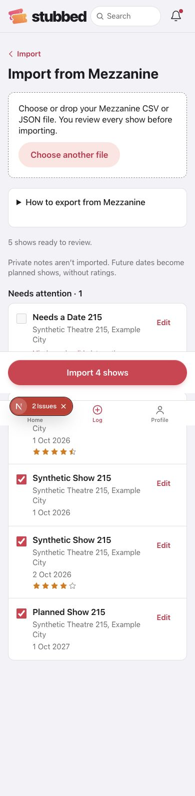
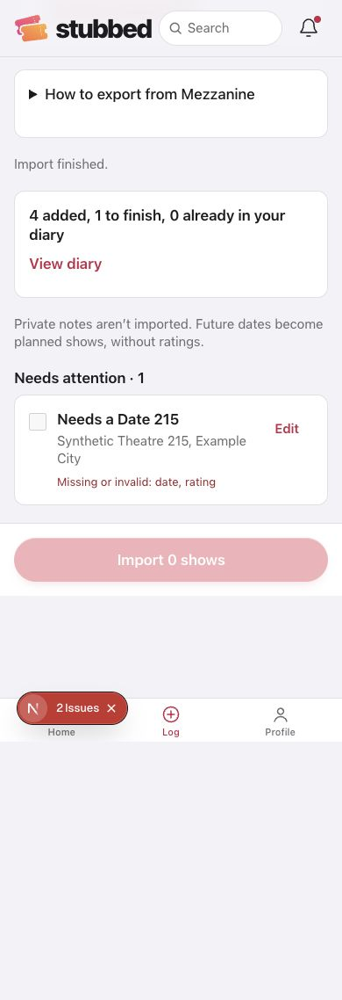
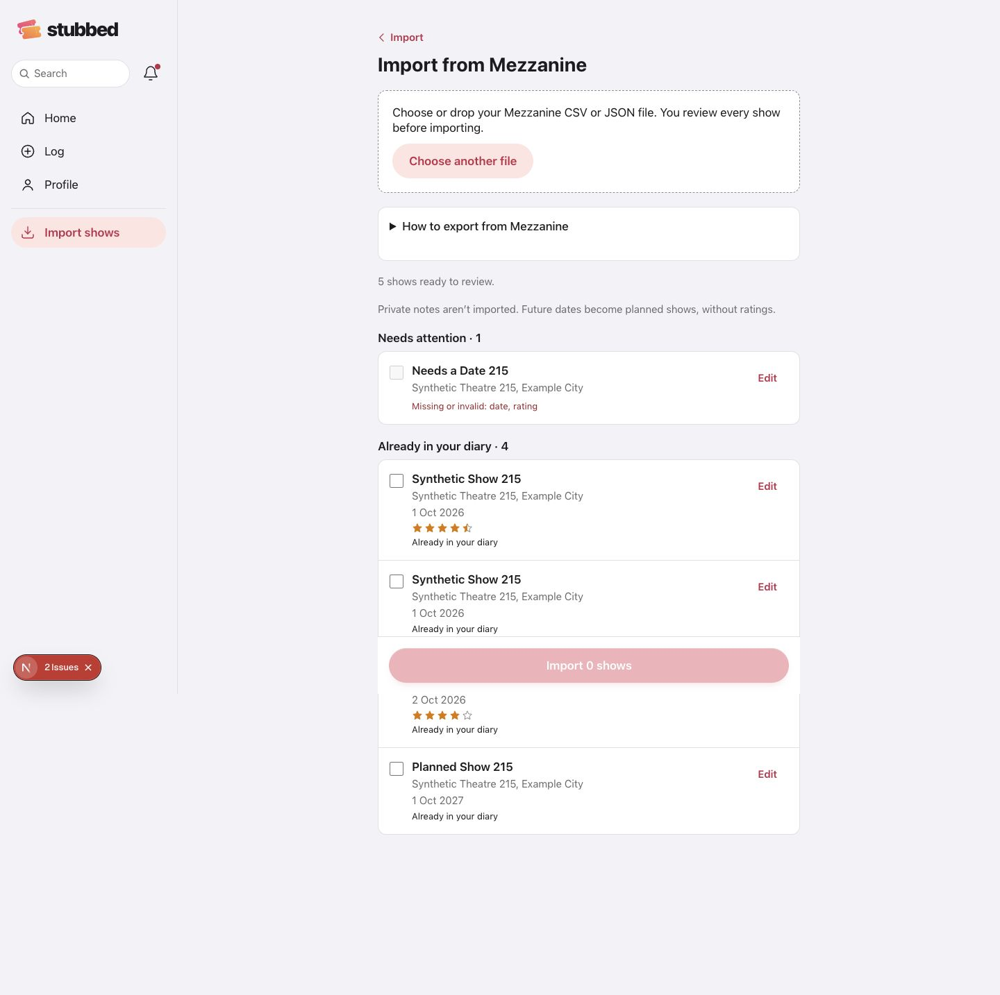
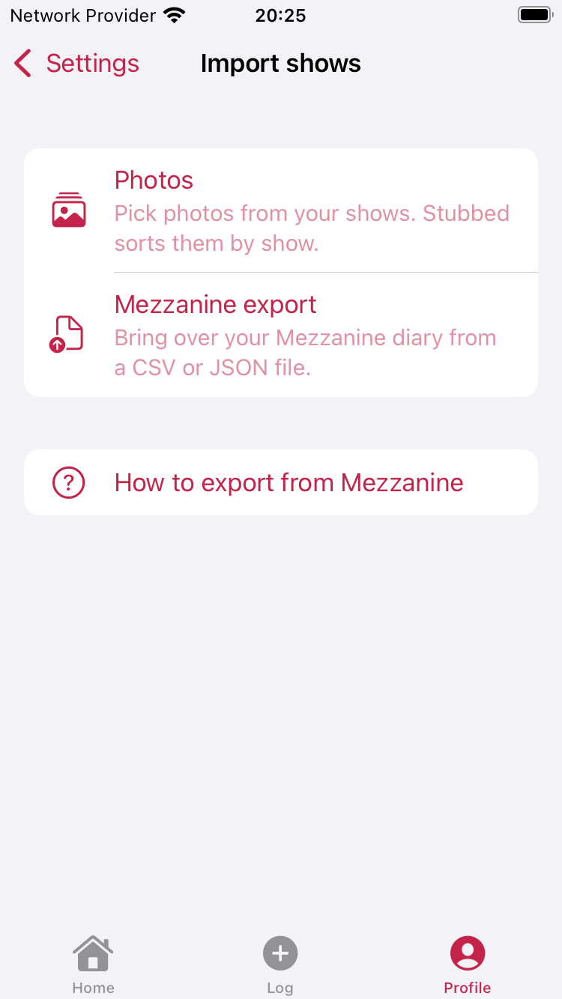
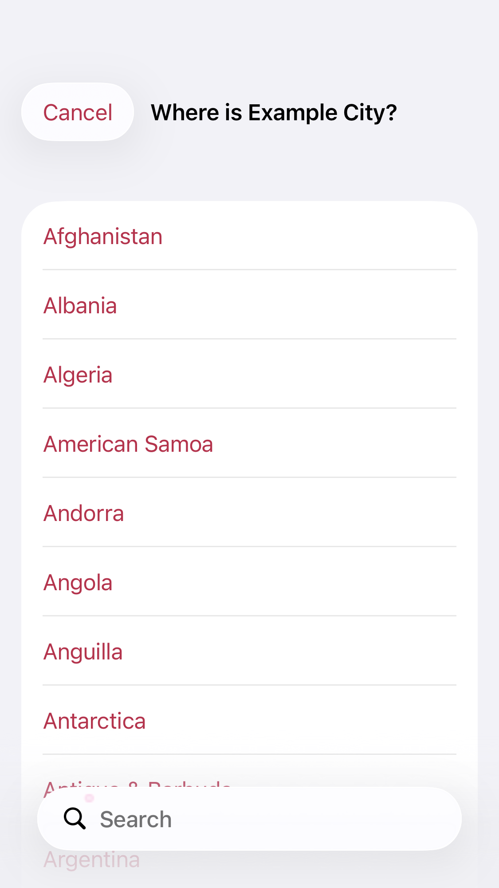
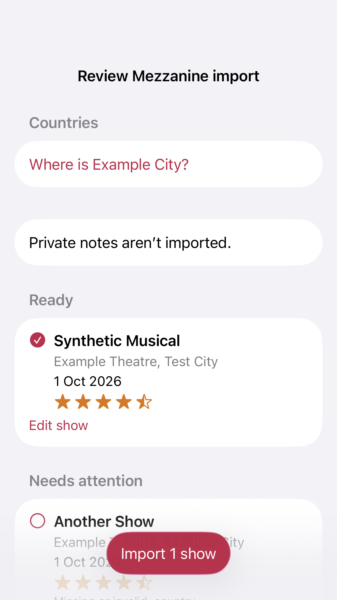
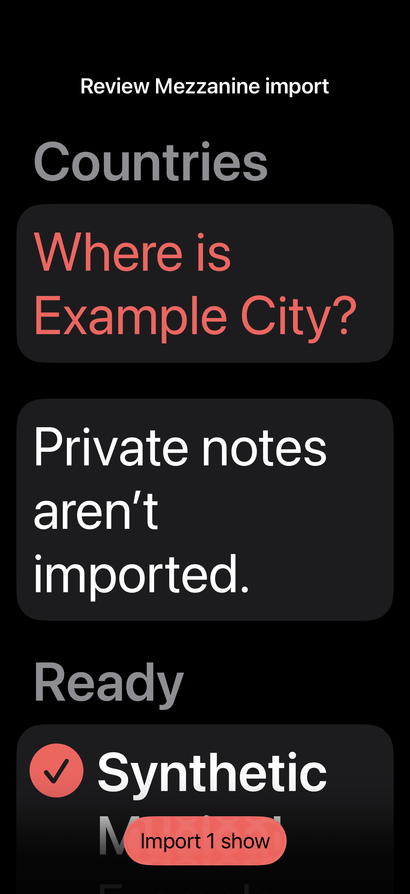
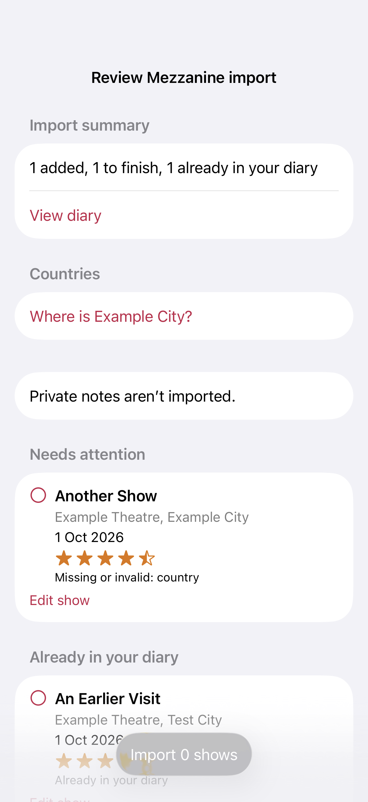

# Import hub and Mezzanine verification

Epic #215, iOS #401 and web #402. All diary data in these screenshots is synthetic.

- Web: checked at 390×844 and 1440×1000. CSV produced five distinct rows, including two same-day visits. One country choice applied to all rows for that city. Four ready rows saved sequentially; the invalid date/rating stayed unsaved. Importing the same visits from JSON then marked all four saved visits as duplicates and selected none. The native keyboard date control and clearing an invalid rating moved the exception into Ready. Keyboard space changed row selection. Neither viewport overflowed horizontally.
- Local database readback: two logged visits for one show on 1 October, another on 2 October, and a planned visit with no rating. The public review retained its comma and line break; private notes were excluded. The new venue carried the selected GB country. No production account was used.
- iOS: the unit suite and four view-rendering tests passed. The Settings → Import shows → export help UI test passed on iPhone 17 Pro and iPhone SE. Review rendering covers a small phone, dark mode with accessibility5 text, country selection, and the summary.
- Before release: check a real Mezzanine file through the iOS system file picker; the exact Mezzanine export menu steps still need the owner's verification. The help intentionally uses generic instructions. The project brief's stale import passages need updating; the attempted connector edit was rejected by automatic approval review, so the brief is unchanged.

