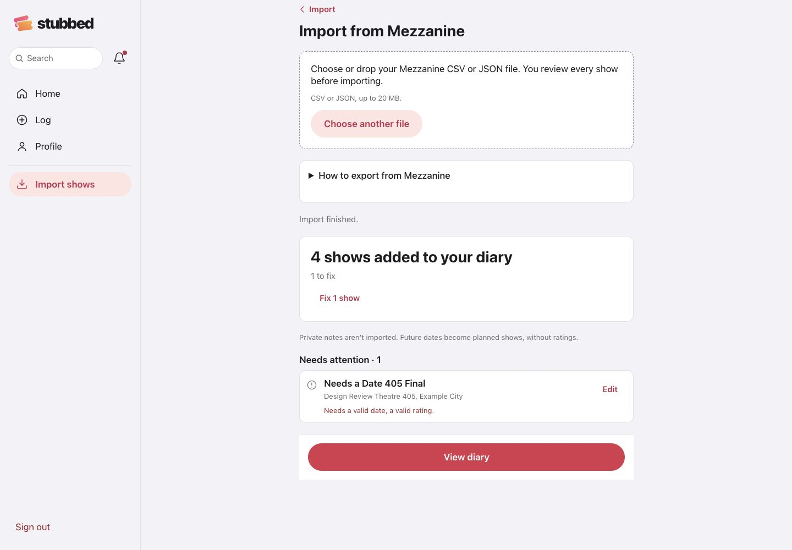
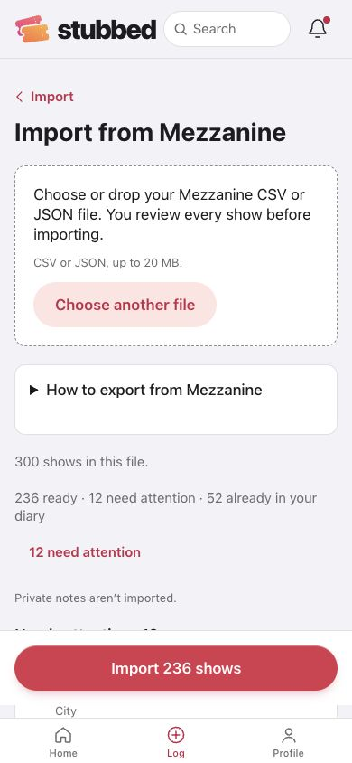
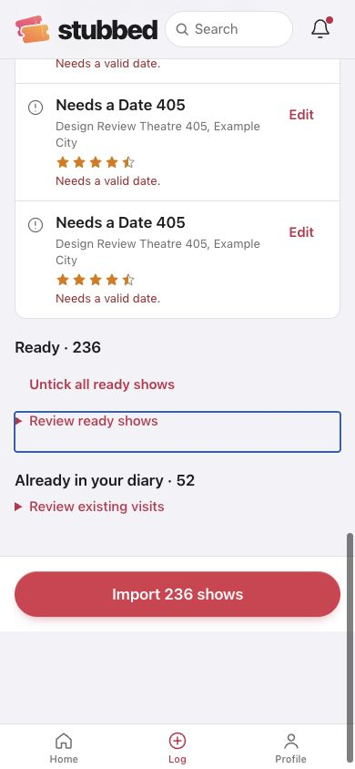
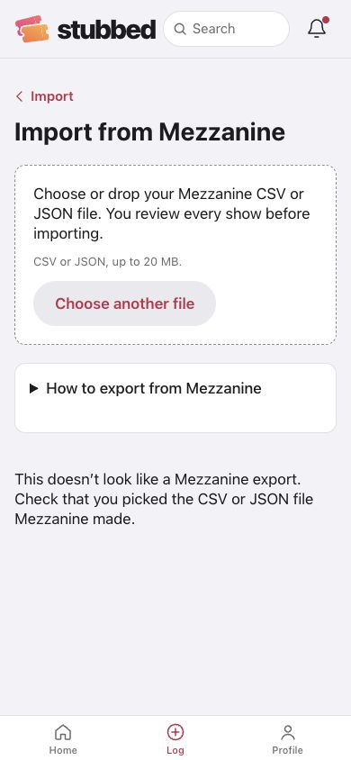
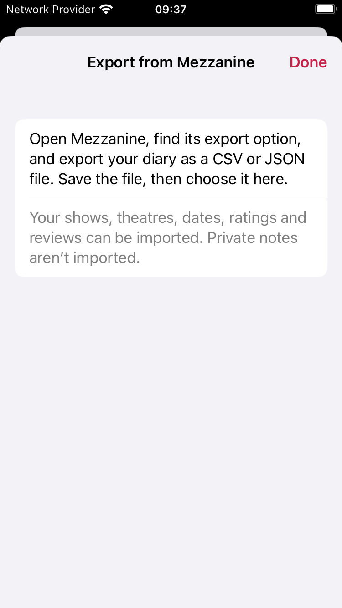
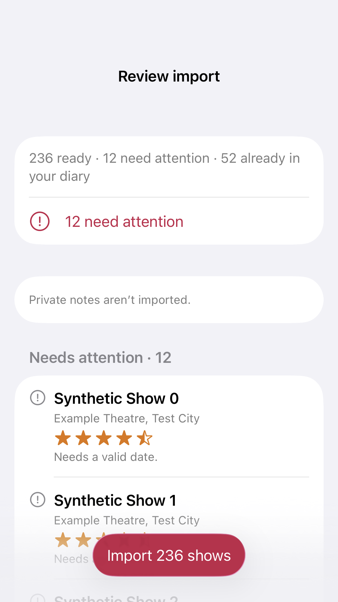

# Import hub and Mezzanine verification

Epic #215, iOS #401 and web #402. All diary data shown here is synthetic.

## Design follow-up, 6 November 2026

The PR design review's five priority findings are addressed on both platforms:

- **Ending:** View diary replaces the disabled Import button after saving. The result names the shows added, omits zero-count details, uses “to fix”, and offers a shortcut to the remaining problems. Web moves keyboard focus to the summary; iOS exposes it as the accessibility focus target.
- **Bulk review:** count summary, jump to problems, untick/select all Ready, and collapsible Ready and existing-visit sections. Both platforms list Needs attention first. iOS uses compact rows, warning glyphs for exceptions, and swipe/context-menu editing instead of competing row buttons.
- **Native hub:** primary titles, secondary subtitles, tinted icons, trailing chevrons, and export help as a normal row in the same section.
- **Countries:** explanation, last-country shortcut, and confirmation naming the city and number of affected shows. Matching still inherits an existing venue's country rather than guessing.
- **Stop:** finishes the active save, retains pending selections and stable entry ids, and offers Continue. Matching can stop between bounded batches and duplicate-query pages without losing the parsed file.

Also addressed: named Edit accessibility actions, h3 editor headings inside h2 groups, control outlines, 20 MB pre-read limit, distinct invalid-file and retryable network errors, shared export-help wording, less prominent Log a show shortcut, and Apply for iOS row edits. The web Choose a file button remains the keyboard equivalent of drag-and-drop. No new share-card or share-extension flow was added from the review's exploratory questions.

## Checks

- Web: 125 tests, lint, typecheck and production build pass.
- iOS: complete unit suite passes on the already-running iOS 27 Simulator; focused import/model tests and five view-rendering cases also pass on iPhone 17 Pro. Settings → Import shows → help UI test passes on iPhone 17 Pro and iPhone SE. The earlier full iOS 26.5 run crashed in the existing OCR fixture; that case passes in the complete iOS 27 run.
- Production-mode browser at 390×844 and 1440×1000: no horizontal overflow or console errors. A 300-row file yielded 236 Ready, 12 Needs attention and 52 existing visits. Untick/select all and keyboard jump-to-problems worked. Stop returned after 9 saves, retaining 227 selected valid rows plus 12 exceptions; Continue ended at 236 added. Local database readback confirmed exactly 236 visits on 236 distinct dates, with no duplicate saves.
- Country selection applied once per city, last-country reuse and the confirmation worked. Completed review had View diary as its primary action, and focus moved to the result. Wrong-file errors offered Choose another file, with no futile Retry. Test fixtures confirm large-file rejection before reads and stop/resume behavior without network calls.

Before release: check a real Mezzanine file through the iOS system picker, the exact Mezzanine export menu steps, and VoiceOver on a device. Export help intentionally uses generic instructions. The project brief was updated with the owner's approval on 5 November.

## Screenshots

