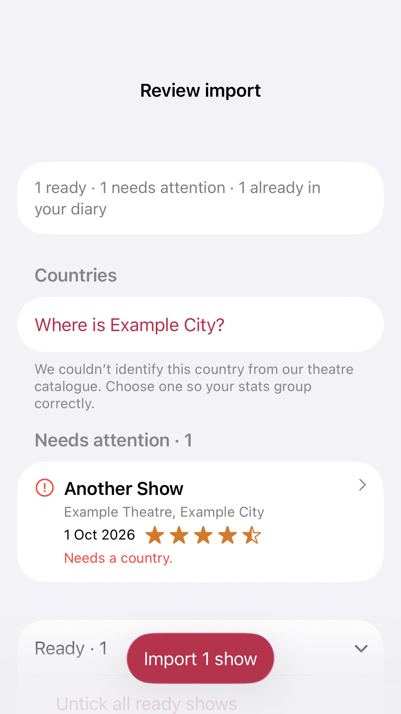
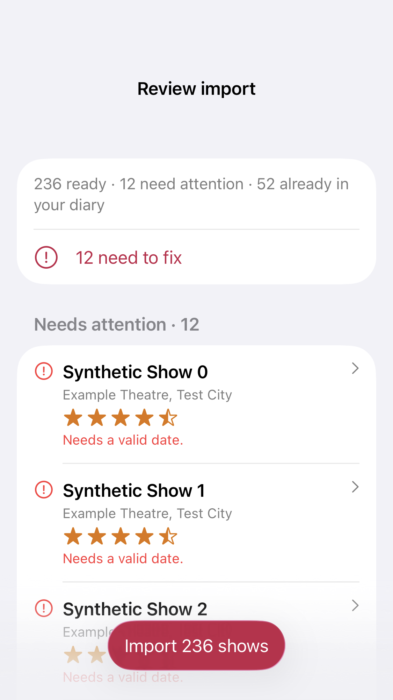

# Import toolbar fix

Actual iOS view renders from five passing MezzanineReviewSnapshotTests, 6 November 2026. The small-phone render is hosted inside a TabView to cover the reported native tab-bar overlap. Review hides the tab bar and keeps the native bottom action toolbar. Private-note notices are removed; parser exclusion remains.

