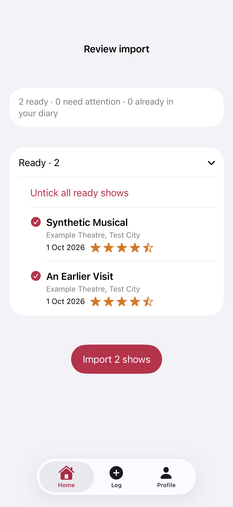

# Import toolbar fix

Actual iOS view renders from five passing MezzanineReviewSnapshotTests, 6 November 2026. The small-phone render is hosted inside a TabView to cover the reported native tab-bar overlap. Review keeps the tab bar visible and places short-file actions in the page and long-file actions in the top navigation bar. Private-note notices are removed; parser exclusion remains.

Six rendering tests pass, including the reported two-ready-show case. Short files (up to 10 rows) use an in-page action; larger files keep Import in the native trailing navigation toolbar. No bottom inset, material strip, or tab-bar appearance override.

